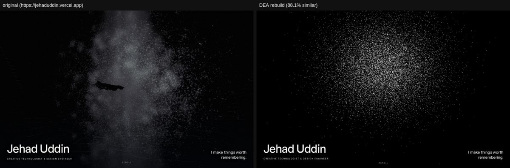

# Examples

Real reports from DEA, saved as they came out (only machine-specific paths were shortened). Each one is a single command.

| Folder | Command | What it shows |
|---|---|---|
| [`jehaduddin-explain/`](jehaduddin-explain/explain.md) | `dea explain https://jehaduddin.vercel.app` | A code teardown of a React + three.js portfolio with no source maps: build, stack, how the app is put together, 67 shader stages, GSAP calls, data. |
| [`jehaduddin-extract/`](jehaduddin-extract/extract.md) | `dea extract https://jehaduddin.vercel.app --to react --verify-build` | A buildable React kit: tokens, motion, the hero's text layout, 12 shader modules with traced uniform values and drivers, a build check, and the visual diff below. |
| [`gsap-investigate/`](gsap-investigate/report.md) | `dea investigate https://gsap.com --goal "what fonts, colours and animation tech does the homepage use, with proof"` | A planned investigation with an evidence index: GSAP 3.15.0 + ScrollTrigger, PP Mori, the colour scheme with contrast, 273 animated elements, 44 ScrollTriggers. |
| [`hn-algolia-api/`](hn-algolia-api/api.md) | `dea api https://hn.algolia.com` | The APIs a page calls, as OpenAPI 3.1 ([`openapi.json`](hn-algolia-api/openapi.json)), with the source line that calls each one (from the site's source maps) and the API key redacted. |

## The extract's visual diff

Left: the original first screen after its intro. Right: DEA's rebuild from the kit (DEA's own React kit, the site's shaders, and
a particle stand-in written by DEA where the site runs a GPU particle simulation).

- Start: 73.2% similar
- After DEA's own analysis (palette, screen colour, each shader, opacity): 88.1%
- After research and retry: 88.1% (searches found no new values to try)
- Final parts: colour 95.9%, brightness layout 79.8%, edges 89.6%

The score compares colour, brightness layout and edges at 96×60: it says the first screen reads the same, not that
the code is identical. Screenshots were taken on a machine without a GPU, so the site's WebGL ran in software.
